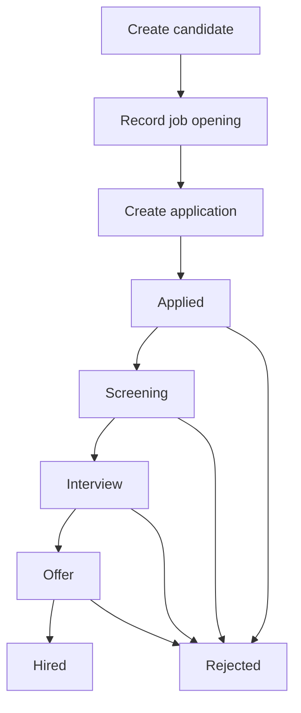

# Recruiting workflow and requirements (fictional)

## Business problem

A small recruiting team tracks applicant statuses in spreadsheets and email. This can make handoffs, reporting, and follow-up inconsistent. The demo illustrates how to structure pipeline information in Salesforce.

## Actors and user stories

- **Recruiter:** As a recruiter, I want to register candidates and connect them to open jobs, so I can track individual applications.
- **Hiring coordinator:** As a coordinator, I want to document scheduled interviews, so I can view next steps.
- **Recruitment manager:** As a manager, I want counts by stage and opening, so I can identify pipeline bottlenecks.

## Process map

## Data model

- Candidate has an email, optional phone, and source.
- Job Opening has a department and state (Open, Paused, Closed).
- Application links Candidate and Job Opening, tracks stage and last change date.
- Interview links Application, stores scheduled time and a simple outcome.

## Implemented automation

1. On application creation, default its stage to **Applied** if absent.
2. Reject an application if either related candidate or opening is missing.
3. On application insertion or stage change, set the last-stage-change date to today's date.

## Proposed next increments (not implemented)

- Salesforce Flow tasks and approval policies.
- Email notifications with consent and audit logging.
- Role-based record visibility and permission sets.
- Duplicate detection and robust uniqueness policies.
- Human-reviewed AI summaries, only after privacy and security review.

**Scope:** demonstration requirements, not a real recruiting deployment. Avoid real applicant data.
